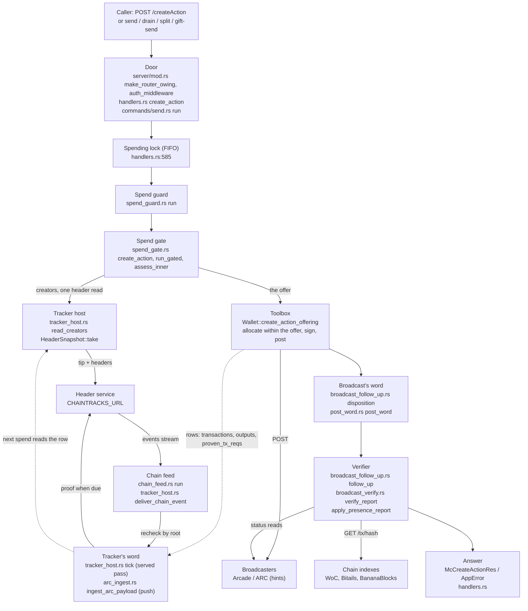
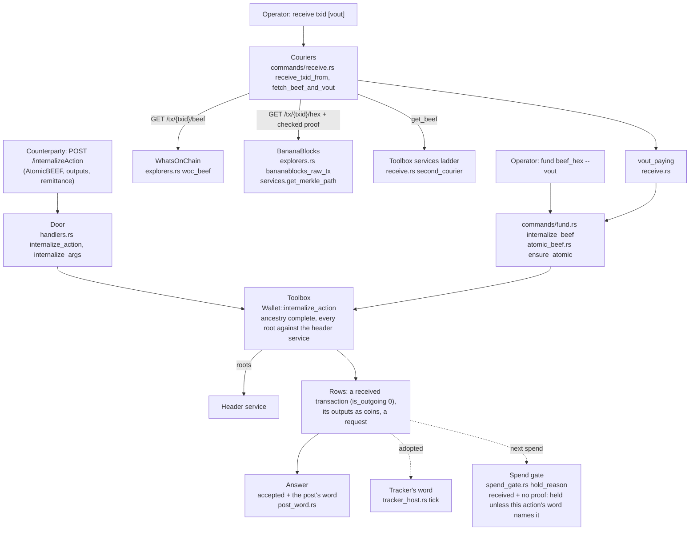
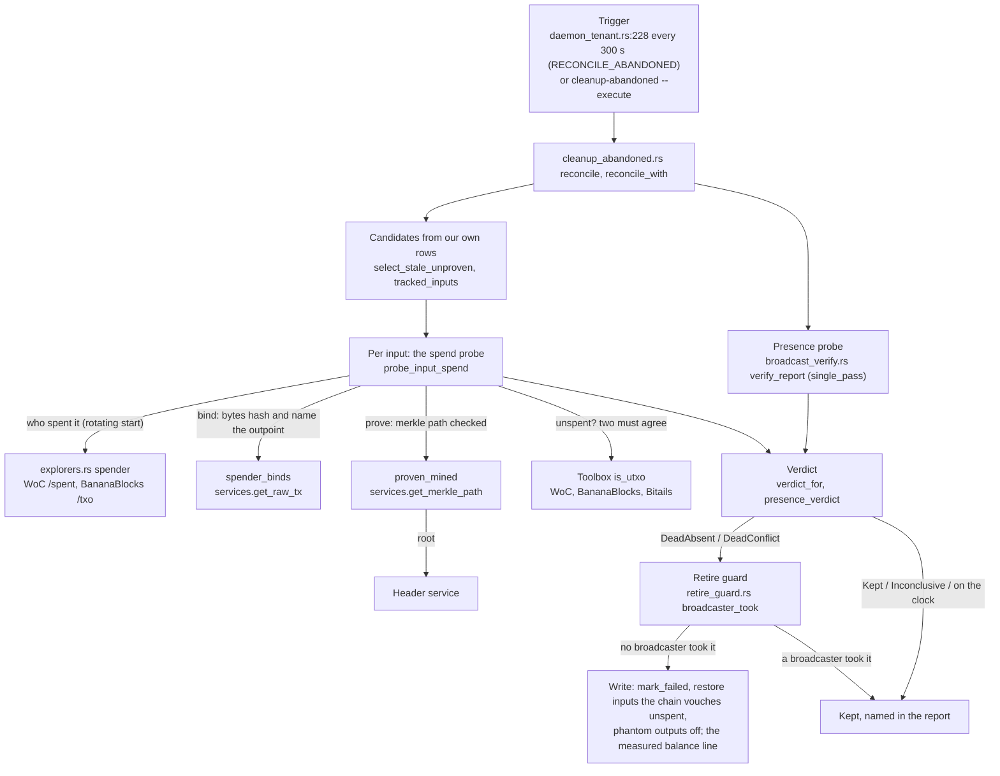

# Architecture: the dataflow and the invariants (#83)

For an engineer who has not read the rulings corpus. This document follows
one spend, one received payment and one repair pass through the tree, names
the file and the function at every hop, states the invariants the code
keeps, and maps every file under `src/` to the machine of the stack it
serves. It restates no rule: where a rule binds, the stack's charter is
cited by section (`~/bsv/bsv-stack-lean/docs/charters/wallet.md`,
`tracker.md`, `broadcaster.md`, read with
`git -C ~/bsv/bsv-stack-lean show origin/main:<path>`), and the test that
holds it today is named. Every claim about behaviour cites a file and line
of this tree at `0.18.0` on `beta` (`08f1f05`), or a test by name; a claim
read from a doc comment and not run or read in the code it describes is
marked `[D]`. The diagrams are Mermaid source; no renderer is in the tree,
so they render where Markdown is viewed (GitHub does) and there is no SVG.

Line numbers are those of `08f1f05`; a later commit moves them, the
function names stay. `python3 -B tools/check-cites` holds every numbered
citation and the module map's line counts at that pin. Each citation names
a Rust identifier before its range in the same sentence or table cell;
the checker reads that range from git and requires the identifier there.
Later modules and tests without coordinates at this pin are cited by name.

## 0. The shape, in one paragraph

One binary, two doors. A CLI command (`Commands`, `src/main.rs:68-229`, one arm per
`Commands` variant of `src/cli.rs`) loads a `WalletContext`
(`src/context.rs:8`) and calls one `run` in `src/commands/`. An HTTP server
(`make_router_owing`, `src/server/mod.rs:202`) serves the 28 BRC-100
endpoints of `src/server/handlers.rs` in the MetaNet Client's JSON
(`src/server/types.rs`), plus five routes that are not BRC-100
(`/permission-audit`, `/permission-audit/reset`, `/chain-feed`,
`/tx/{txid}`, `/arc-callback`; `permission_audit`, `src/server/mod.rs:225-304`). Both doors stand on the same engine, the
toolbox `bsv-wallet-toolbox-rs` (`Wallet<StorageSqlx, Services>`: the
coins, the locks, the signing, the posting, the monitor), and the toolbox on
`bsv-rs`. Around the toolbox's doors this crate adds the hosts of two stack
machines: the spend gate (`src/spend_gate.rs`, the wallet charter's section
2 applied to coin selection) and the tracker host (`src/tracker_host.rs`,
the tracker charter's sections 0 and 2: one word per transaction, written only from
headers and proofs). `daemon` (`run`, `src/commands/daemon.rs:10`, through
`start`, `src/commands/daemon_tenant.rs:39`) runs the toolbox's monitor, the header
service's chain-event feed (`chain_feed::run`, `src/chain_feed.rs:167`), the served pass
(`spawn_served_loop`, `src/broadcast_reconcile.rs:693`) and the server; `serve`
(`run`, `src/commands/serve.rs:6`) runs the server and the served pass only. The
one headers machine is the header service at `CHAINTRACKS_URL`
(read at start where the services are built, `CHAINTRACKS_URL` at
`src/services_env.rs:234`, and by the tenant, `CHAINTRACKS_URL` at
`src/commands/daemon_tenant.rs:101`; the later #80 `src/config.rs` reads it
after the pin; required where services are built,
no default: `chaintracks_url_for`, `src/services_env.rs:48`); explorers are asked only
at the break-glass sites `tests/rule_28_sites.rs` lists.

## 1. One spend

**Hop 1, the door.** Over HTTP the request passes the layers including
`DefaultBodyLimit` (`src/server/mod.rs:308-317`) in the order a layer added later runs earlier: the
body cap (none on the two BEEF doors, `DefaultBodyLimit`, `src/server/mod.rs:238-245`),
tracing, the extensions (`ServerConfig`, the `SpendingLock`, the
`BroadcastVerifier`), the bearer auth (`auth_middleware`,
`src/server/mod.rs:110`) before any body is read, then the lenient JSON body,
CORS, and `heal_owed` (`src/server/mod.rs:308`), which retries the start's
heal before any handler runs. `create_action` (`src/server/handlers.rs:473`) reads the
originator from `Origin` or `Originator` (`extract_originator`,
`src/server/handlers.rs:102`), reads the action's word for R1 (d) from the
body's `allowPending` and nowhere else
(`AllowPending::from_json`, `src/server/handlers.rs:483`,
`src/spend_gate.rs:251`), maps the MetaNet shapes to the SDK's
`CreateActionArgs` (outputs with `basket`, `customInstructions`, `tags`;
caller-named inputs; `src/server/handlers.rs:499-564`) and records the
permission audit entry (`spend_entry`, `src/server/audit.rs:118`). A command does the same
without HTTP: `send` (`run`, `src/commands/send.rs:9`), `drain`
(`run`, `src/commands/drain.rs:12`), `split` (`run`, `src/commands/split.rs:17`) and
`gift-send` (`run`, `src/commands/gift_send.rs:71`) each build their args, read the
word from `--allow-pending` and `--coin` before the wallet is opened
(`word`, `src/main.rs:233`), and heal any hold a 0.15 process left
(`heal_before_spend`, `src/spend_gate.rs:1328`); the four copies of this
sequence are what #78 folds into one.

**Hop 2, the lock.** The served door takes the process-wide FIFO mutex
(`spending_lock`, `src/server/handlers.rs:585`) and holds it through the guard, the gate, the
toolbox's allocation, signing and immediate post, releasing `_guard` (`src/server/handlers.rs:604`) before the answer is built. The commands take
no lock: a command is one process. This is the hold #86 shortens to the
allocation alone.

**Hop 3, the guard.** `spend_guard::run` (`src/spend_guard.rs:70`) begins by
reserving a respend's inputs (`respend::reserve_inputs`,
`src/respend.rs:455`), then releases every hold whose transaction a status
source now holds and holds every spendable coin of a transaction whose last
word is the toolbox's immediate-refusal note (`immediateBroadcastHint`,
`src/server/post_word.rs:25`) with no status source holding it since
(`IMMEDIATE_HINT`, `src/spend_guard.rs:78-151`). It writes `spendable` and its own
`spend_guard_holds` table only, never a transaction or request word
(`src/spend_guard.rs:14-22`). Over HTTP a fault here is answered by its type
(`AppError::from_pre_door`, `src/server/handlers.rs:196`: the store busy is
503 `STORE_BUSY`, anything else 500).

**Hop 4, the gate's offer.** `spend_gate::create_action`
(`src/spend_gate.rs:1371`) refuses a scoped word that names a coin this
wallet could not spend under it before anything else is read
(`check_scope`, `src/spend_gate.rs:1463`; `GateError::Scope`, the route's
400); judges every caller-named input coin by coin (`assess_named`,
`src/spend_gate.rs:1185`; one held is `INPUT_NOT_OFFERED`, 403); strips any
caller's copy of the rule label and appends the gate's own when the word is
on (`RECEIVED_PENDING_LABEL`, `src/spend_gate.rs:1437-1443`), so the toolbox
writes the word inside the action's own transaction. `run_gated`
(`src/spend_gate.rs:1509`) then reads the candidates (`candidates`,
`src/spend_gate.rs:922`: change coins of the default basket, unspent, their
transaction `completed` or `unproven`, with the frozen record joined) in the
toolbox's own preference, a batch of creators at a time
(`assess_inner`, `src/spend_gate.rs:1044`; `BATCH` 32,
`src/spend_gate.rs:134`), until the coins offered cover the outputs plus a
margin (`FEE_MARGIN`, `src/spend_gate.rs:136`); a creator the header
service did not answer for is read once more after a two-second pause, once
per call (`read_batch` in `src/spend_gate.rs`, #59). Each coin's hold or offer is
`hold_reason` (`src/spend_gate.rs:878`) over its creator's reading: mined at
depth and not suspect, offered; our own `made` change under
`SPEND_OWN_CHANGE`; a received pending coin under this action's word and
within its scope; a stale creator's coin under the same rules, as a pending
one's (ruling 7a, #162); frozen, rejected, conflicted, abandoned or under an
open split, held with its reason. After the door, the lineage
(`lineage_candidates`, one read of the store for the whole call, #163):
our own coin whose creator spent an output of a dead action of this
wallet, made or received, or of one of its dead lineage, is held
`dead lineage: ancestor <txid> <word>` under every rule and word, mined
included. Dead is the tracker's stored word `conflicted`, `rejected` or
`abandoned`, or the toolbox's `failed` status (the CLI's abandon), read as
the door reads it: a candidate holding a proof is read only when one of
its heirs is an eligible creator of the call (for the allocation every
eligible creator, later lazy batches included; for the named door the
eligible named creators), with its creators in one `read_creators` call; the allocation's door and `createAction`'s
named inputs re-read once what faulted (`read_batch`); `respend`'s exact
inputs read once. The dead set is derived after each door's reading, and
a proof that checks reads it mined, so it is not dead (`Lineage::dead`;
`lean/Wallet.lean` `State.skel`, `lean/Tracker.lean`
`onProof_of_rootChecks`). The offer is capped at the largest
`OFFER_CAP` coins (`src/spend_gate.rs:146`, `cap_offer`).

**Hop 5, the creators' reading.** The gate reads no explorer and decides
from the wallet's own rows and one read of the header service:
`read_creators` (`src/tracker_host.rs:2029`) loads each creator's tracker
row or, failing one, the toolbox's stored merkle path (`proven_txs`) as a
row's input, takes one `HeaderSnapshot` (`HeaderSnapshot::take`, `src/tracker_host.rs:150`: the tip
once, one header per height a stored path names), replays each row against
it (`TrackedRow::replay`, `src/tracker_host.rs:658`: a stored path is
checked again, never trusted by age), runs the charter's spend guard
(`readme_spend_guard`, `src/tracker_host.rs:1937`: a spend attempt, then a
recheck), and reads the depth (`deep_enough`, `src/tracker_host.rs:2101`,
the tip is 1, `SPEND_DEPTH` the floor of 1) and the open-split floor
(`open_split_floor`, `src/tracker_host.rs:2139`). Nothing is written here:
the rows are not stored back (`read_creators`, `src/tracker_host.rs:2027-2029`). A header
service fault is a `CreatorReading` with `headers_fault` set
(`src/tracker_host.rs:1985-2010`), which the gate reads as "could not look",
never as a hold on the coin.

**Hop 6, the toolbox's allocation and signing.** `run_offered`
(`src/spend_gate.rs:1355`) makes the one call,
`Wallet::create_action_offering(args, originator, offer)`: the toolbox
allocates within the offer and locks within it in its one write transaction
(held by the test `the_offer_allocates_only_the_offered_coins_and_writes_no_hold`,
`src/spend_gate/tests.rs:845`), signs, and posts to the broadcasters it is
configured with (`services_options_from_env`, `src/services_env.rs:228`, the pinned
environment-to-services resolver; the later `Config` is read once at start) `[D]` the toolbox's internals beyond what the tests drive. When
it answers `Insufficient funds` or `Unspendable coin:` on a lazy offer, every
coin is read and the call made once more (`assess_inner`, `src/spend_gate.rs:1525-1554`; the
unspendable case held by
`an_unspendable_coin_in_the_lazy_offer_falls_through_to_every_coin`,
`src/spend_gate/tests.rs:898`); when that fails for
funds the refusal lists every coin held back with its reason and the coins
live actions hold (`refusal`, `src/spend_gate.rs:1557`; `locked`,
`src/spend_gate.rs:981`), and when the coins held on the header service's
fault could have covered the action the refusal is `HEADERS_UNAVAILABLE`
instead (`headers_fault`, `src/spend_gate.rs:1573-1578`).

**Hop 7, the broadcast's word.** The toolbox's answer carries
`sendWithResults`: `unproven` is a broadcaster's acceptance, `sending` is no
accepting word (a refusal, a transient fault, no broadcaster reached), and
`disposition` (`src/server/broadcast_follow_up.rs:71`) reads it as
`Accepted`, `Ambiguous` or `NotBroadcast` (`noSend`,
`acceptDelayedBroadcast`, a deferred-signing template). For a `sending`
result the answer carries the request's own word, read from its history
(`post_word`, `src/server/post_word.rs:62`; `src/server/handlers.rs:685-690`):
the refusal is a hint on the record, the inputs stay locked, nothing is
released.

**Hop 8, the verifier.** `follow_up` (`src/server/broadcast_follow_up.rs:117`)
spawns the presence probe for an accepted broadcast and answers at once;
runs it inline for an ambiguous one. The probe
(`BroadcastVerifier::verify_report`, `src/broadcast_verify.rs:732`) asks the
broadcaster the wallet submitted through, then the chain indexes as
one question (`ask_chain_indexes`, `src/broadcast_verify.rs:948`: WoC,
Bitails, BananaBlocks with a rotating start), over a schedule of rounds
(`delay_before_round`, `src/broadcast_verify.rs:709`). A chain-index hit ends it as `Confirmed`
with chain evidence; a store holding the bytes ends it as `Confirmed`;
`Rejected` needs the broadcaster's and the chain indexes' clean absences
both (`AbsenceAuthority`, `src/broadcast_verify.rs:294`; `is_definitive`,
`src/broadcast_verify.rs:398`); anything less is `Inconclusive`.
`apply_presence_report` (`src/server/broadcast_follow_up.rs:190`) writes
network evidence to the toolbox's broadcast memory for the txid and for
every unproven ancestor the package carried, and on `Rejected` asks the
retire guard (`retire_guard::broadcaster_took`, `src/retire_guard.rs:47`:
the wallet's own request, memory and tracker rows) before
`retire_rejected_broadcast` (`src/server/broadcast_follow_up.rs:296`), the
toolbox's release-rule path; a transaction a broadcaster took is kept. An
inline `Rejected` that retired the transaction answers 502
`BROADCAST_REJECTED` (`AppError::broadcast_rejected`, `src/server/handlers.rs:678-683`;
`AppError::broadcast_rejected`, `src/server/handlers.rs:281`). A store fault
after the post is logged with its marker and never the call's error
(`post_broadcast_follow_up_write_failed`,
`src/server/broadcast_follow_up.rs:203-240`). The commands run the same
verifier inline (`into_send_result`, `src/commands/send.rs:73-77`; `into_send_result`,
`src/broadcast_verify.rs:160`).

**Hop 9, the answer.** The BEEF the toolbox returns is converted to
AtomicBEEF for the `tx` field (`atomic_beef`, `src/server/handlers.rs:616-634`); the
deferred-signing reference is decoded back to the string the toolbox keys
its cache by (`reference_string`, `src/spend_gate.rs:699`); the body is
`McCreateActionRes` (`src/server/types.rs`). At the pin a refusal is
`AppError` (`src/server/handlers.rs:122`), with the text-to-status mapping in
`AppError::classify` (`src/server/handlers.rs:132`). The gate's typed errors
reach `from_gate_error` (`src/server/handlers.rs:234`: 503
`HEADERS_UNAVAILABLE`, 400 `VALIDATION_ERROR`, 403 `INPUT_NOT_OFFERED`, 402
`INSUFFICIENT_FUNDS` with `offeredSatoshis` and `held`); a wallet error's
busy variant reaches `from_wallet_error` (`src/server/handlers.rs:213`),
and a pre-door store busy is read by `store::is_store_busy`
(`src/store.rs:75`). The later #81 extraction into `src/server/error.rs`
and `src/toolbox_words.rs` replaces the prefix mapping with `Kind::answer`
and isolates the toolbox's erased error words in `toolbox_words::class`.
Those modules did not exist at the pin; their mapping is held by the named
tests `the_typed_mapping_serves_what_the_prefix_table_served` and
`the_typed_wallet_busy_from_the_door_is_503_retry_after_one`.
Under `--json` the
commands print the same body and exit 1 (`refused_as_json`,
`src/spend_gate.rs:570`; `busy_as_json`, `src/spend_gate.rs:598`).

**Hop 10, the tracker's word.** The transaction now has rows in the
toolbox's `transactions` and `proven_tx_reqs`. The served pass
(`run_served_pass`, `src/broadcast_reconcile.rs:653`, every
`BROADCAST_RECONCILE_INTERVAL_SECS`, spawned by `spawn_served_loop`,
`src/broadcast_reconcile.rs:693`, from `src/commands/daemon_tenant.rs:167`
or through `spawn_serve_loop`, `src/broadcast_reconcile.rs:679`, from
`src/commands/serve.rs:44`) runs the tracker's pass
(`tracker_host::tick`, `src/tracker_host.rs:1304`): every `unproven` or
`sending` transaction of the wallet is adopted at `built`
(`src/tracker_host.rs:1317-1325`), the broadcasters' words in the broadcast
memory are fed as hints (`MemoryHints`, `src/tracker_host.rs:259`), the
clock ticks, and for each re-ask that is due one proof is asked of the
toolbox's couriers (`Courier`, `src/tracker_host.rs:321`) and checked by
the tracker against the snapshot. A proof also arrives pushed: Arcade's
webhook (`arc_callback`, `src/server/mod.rs:328`; `ingest_arc_payload`,
`src/arc_ingest.rs:61`, the toolbox's one judgment for the SSE frame and the
webhook) and, under `daemon`, the monitor's own backstop (`[D]` the
toolbox's `check_for_proofs`; its provider logged by
`log`, `src/backstop_log.rs:86`). The word is served at `GET /tx/{txid}`
(`tx_word`, `src/server/mod.rs:629`; `stored_word`,
`src/tracker_host.rs:901`) as a view; nothing is decided from it.

**Hop 11, the feed.** Under `daemon` the chain-event feed
(`chain_feed::run`, `src/chain_feed.rs:167`) replays the header service's
journal from the stored cursor and then holds its stream
(`Feed::replay`, `src/chain_feed.rs:343`; `Feed::stream`,
`src/chain_feed.rs:376`). Each envelope goes to `deliver_chain_event`
(`src/tracker_host.rs:2344`): the rows the event names by index (mined at or
above a fork, reorg or split height; marked rows for a tip; the rows on an
invalidated block's hash; `ChainEvent`, `src/tracker_host.rs:2361-2394`) are replayed
against the new branch's headers, read before the write lock
(`HeaderSnapshot::take`, `src/tracker_host.rs:2403-2408`), and `Tracker::on_chain` rechecks each by
its stored root. The deactivated set in `deliver_chain_event` holds a
reorg's supplied headers and an invalidated block at each named row's stored proof height,
with the hash matched by `header_hash` and the root computed from `bump`.
It keeps every deactivated hash at a height, never one in place of
another, so a kept invalidation survives a later reorg's header at its
height and a kept reorg survives a later invalidation's: the new branch
has no answer where the service answers any of them, and the stored proof
replays against the deactivated header whose hash is the row's
`header_hash` (else the latest event's at that height), the header it was
checked against, as checked by
`a_reorg_at_a_kept_invalidations_height_keeps_the_invalidation`,
`an_invalidation_at_a_kept_reorgs_height_keeps_the_reorg` and
`two_kept_events_at_one_height_replay_the_proof_against_its_own_header`.
`lowercase_chain_event` normalizes hash, root and txid fields before delivery
and when kept events decode for replay, as checked by
`an_uppercase_invalidated_alert_matches_the_lowercase_alert`,
`an_uppercase_kept_invalidation_matches_lowercase_on_read_and_tip`,
`an_uppercase_reorg_matches_the_lowercase_reorg`,
`an_uppercase_frozen_outpoint_is_recorded_lowercase_and_held` and
`kept_events_normalize_hash_fields_in_every_arm`.
Split keys follow bsv-tracker 0.8.0's `split:<64 hex digits>` contract: the
common ancestor's display-order hash accepts either case. Both `split` and
`splitResolved` lowercase that hash at delivery, preserving the `split:`
prefix. `read_open_splits` also normalizes records stored before that rule;
case variants collapse to one entry at the lower fork height, preserving
every affected coin's hold. Resolution in either case clears the open floor
and releases that hold, as checked by the split-key tests in
`tracker_host::tests`. Other key shapes are refused by the decoder before
delivery.
`an_invalidated_block_holds_its_coin_until_a_tip_rechecks_it` checks that
when the service still answers that hash, the new branch has no answer
there: the word stays suspect with `recheck`, and the stored event
reconstructs that deactivation on reload. The stored proof checks against
the old header and the event rechecks against the new branch.
A tip reads kept reorgs and invalidations alike: if replay already cleared
its mark on a new header carrying the same root, delivery stores only plain
`mined` (not suspect, no re-ask) and clears the stored re-ask and kept events,
leaving no row for the next tip to select. A stored verdict's recheck leaves
the row untouched by this fallback.
`a_reorg_on_a_lagging_service_then_a_same_root_tip_settles_the_row`
checks that the stored word agrees with the spend door;
`a_settled_row_is_not_selected_by_the_next_tip` checks the next tip leaves it
untouched. `same_root_tips_leave_a_kept_reorg_with_a_stored_verdict_unchanged`
checks that a verdict's recheck changes neither the word nor the kept events
on two tips. `a_reorg_on_a_lagging_service_then_a_moved_root_tip_reads_stale`
guards beta's unchanged moved-root reading. This fallback changes no
other event's delivery.
`an_invalidated_blocks_moved_root_reads_stale_after_the_next_tip` checks
that a later tip on a moved root stores `stale` with `reorg@<height>`.
`an_invalidated_block_whose_root_already_moved_reads_stale_at_delivery`
checks the same stale word when the service already answers another root
at delivery, its retained proof and event after a tick, and its coin under
the pending tier's rule.
`an_invalidated_hash_no_row_was_checked_against_changes_nothing` guards
beta's unchanged behaviour for an unrelated hash; it is not evidence of
the invalidation fix. On a new header: the same root, the word stands
(`a_reorg_whose_new_block_carries_the_root_moves_nothing_and_fetches_nothing`,
`src/chain_feed_tests.rs:716`); the root gone, `stale` with the re-ask
`reorg@<forkHeight>` (`a_reorg_on_the_feed_stales_the_word_and_the_new_proof_mines_it`,
`src/chain_feed_tests.rs:192`); no header, suspect until the next tip
(`step_3_a_reorg_before_the_service_moves_leaves_the_word_suspect_until_the_next_tip`,
`src/chain_feed_tests.rs:679`).
A freeze writes `frozen_outpoints` (`src/tracker_host.rs:2409-2420`); the
cursor is written in the same transaction (`tracker_meta`, `feed_cursor`).
A fault stops the loop at its cursor and is served at `GET /chain-feed`
(`chain_feed_status`, `src/server/mod.rs:597`). The next spend's hop 5 reads
these rows: the loop closes without a sweep.

## 2. One received payment

**Hop 1, the door.** `internalize_action` (`src/server/handlers.rs:716`)
reads the originator, maps the MetaNet body to `InternalizeActionArgs`
(`internalize_args`, `src/server/handlers.rs:752`: `paymentRemittance` and
`insertionRemittance` passed through, `basket` and `tags` kept) and strips
the gate's rule label from the caller's labels
(`strip_rule_label`, `src/server/handlers.rs:777-780`; `strip_rule_label`,
`src/spend_gate.rs:746`), so a forged label grants nothing. The body cap is
off on this door (`DefaultBodyLimit`, `src/server/mod.rs:242-245`): a valid BEEF is never
refused for its size, invalid bytes are refused at their offset
(`served_beef_doors.rs`, `an_invalid_beef_over_the_old_body_cap_is_refused_at_its_byte`).

**Hop 1', the couriers (`receive`).** A payment to the bare deposit address
arrives with no BEEF, so `receive_txid_from` (`src/commands/receive.rs:45`)
fetches one through a ladder (`fetch_beef_and_vout`,
`src/commands/receive.rs:83`): WhatsOnChain's BEEF route
(`Explorers::woc_beef`, `src/explorers.rs:316`), then BananaBlocks' bytes
bound to the txid with a merkle path the wallet's services return only after
its root met the header service (`bananablocks_courier`,
`src/commands/receive.rs:141`; `bananablocks_raw_tx`,
`src/explorers.rs:332`), then the toolbox's `get_beef`
(`second_courier`, `src/commands/receive.rs:171`). A fault at a rung (a 429,
a closed rung, bytes that do not hash, no checked proof) moves to the next
at once; no courier delivering is "could not look" with every reason
(`second`, `src/commands/receive.rs:110-127`; the test
`no_courier_delivering_is_could_not_look_with_both_reasons`,
`src/commands/receive.rs:535`). The paying output is read from the
delivered transaction's own bytes, never from an explorer's decode
(`vout_paying`, `src/commands/receive.rs:194`). Every explorer call logs
`explorer_call` (`log_call`, `src/explorers.rs:415`). `fund` takes the BEEF
as an argument and goes to hop 2 directly (`internalize_beef`,
`src/commands/fund.rs:23`), after `ensure_atomic` (`src/atomic_beef.rs:16`)
refuses invalid bytes and prepends the AtomicBEEF header. The sender's
identity for a bare-address payment is the BRC-29 "anyone" key
(`KeyDeriver::anyone_key`, `src/commands/fund.rs:30-31`;
`KeyDeriver::anyone_key`, `src/brc29.rs:19`).

**Hop 2, the toolbox's check.** `Wallet::internalize_action` refuses an
incomplete ancestry and checks every merkle root the BEEF carries against
the header service before anything is stored (`[D]` the toolbox's
`internalize_action.rs`, cited at `src/spend_gate.rs:39-43`; held on this
side by `l2_stub_refusal_names_txid_courier_reason_and_stores_nothing`,
`src/commands/receive.rs:296`, and `test_internalize_action_invalid_tx`,
`tests/integration.rs:866`). What it stores is a received transaction
(`is_outgoing` 0), its outputs as coins of the default basket, and a
request for the transaction's own post.

**Hop 3, the answer and the word.** The answer is `accepted` with, when the
toolbox's post of the internalized transaction drew no accepting word, the
request's hint (`post_word`, `src/server/handlers.rs:739-747`; `post_word`,
`src/server/post_word.rs:62`). The tracker's pass adopts the transaction
while it is `unproven` (`src/tracker_host.rs:1317-1325`), so `GET
/tx/{txid}` answers for it, and the monitor's or the couriers' proof moves
its word to `mined`.

**Hop 4, the coin at the next door.** At the next spend's hop 4 the coin is
a candidate with origin `received` (`candidates`, `src/spend_gate.rs:922-979`,
`is_outgoing`), and `hold_reason` (`src/spend_gate.rs:878`) offers it with
no rule only once its creator is `mined` at depth; while its creator's word
claims nothing about the chain it is offered only under this one action's
`allowPending: received` (or the scoped form naming it) and held otherwise
with the reason `received, no proof; ...` and its rule hint
(`ALLOW_PENDING_HINT`, `src/spend_gate.rs:157-160`),
whatever `SPEND_OWN_CHANGE` says. The action that spends it carries the
label `spend-gate:received-pending`, shown as `underRule` by `/listActions`
(`with_rules`, `src/server/handlers.rs:1134`).

## 3. One repair pass: the abandoned-transaction reconcile

The passes that write the store outside a door are `cleanup-abandoned`
(`src/commands/cleanup_abandoned.rs`), `reconcile-outputs`
(`src/commands/reconcile_outputs.rs`), `reconcile-broadcasts`
(`src/commands/reconcile_broadcasts.rs` over `broadcast_reconcile::run_pass`,
`src/broadcast_reconcile.rs:358`), `reproof` (`src/commands/reproof.rs`),
`sync` (`src/commands/sync.rs`), and the served pass's sweep
(`run_sweep`, `src/broadcast_reconcile.rs:490`). They share the evidence
reads #79 names; the one followed here is the daemon's abandoned-transaction
ticker, because it touches money and runs every pass through the two
guards.

**Hop 1, the trigger.** `daemon_tenant::start` spawns the ticker
(`tokio::spawn`, `src/commands/daemon_tenant.rs:189-307`): every 300 s, when
`RECONCILE_ABANDONED` is not off, `cleanup_abandoned::reconcile`
(`src/commands/cleanup_abandoned.rs:187`) runs with `execute` true and the
minimum age `RECONCILE_ABANDONED_MIN_AGE_SECS`, followed by the poisoned
chain sweep (`run_sweep`, `src/broadcast_reconcile.rs:490`). By hand the
same pass is `cleanup-abandoned` (`run`, `src/commands/cleanup_abandoned.rs:834`),
a dry run unless `--execute`.

**Hop 2, the candidates.** `reconcile_with`
(`src/commands/cleanup_abandoned.rs:526`) reads the default basket's
spendable sum before anything else (`default_basket_sats`, `src/commands/balance.rs`), then
the wallet's own `unproven` transactions older than the minimum age
(`select_stale_unproven`, `src/commands/cleanup_abandoned.rs:782`) and the
coins each one locks (`tracked_inputs`,
`src/commands/cleanup_abandoned.rs:418`). No chain scan: the candidates come
from the wallet's graph.

**Hop 3, the spend probe, per input.** `probe_input_spend`
(`src/commands/cleanup_abandoned.rs:290`) asks who spent the outpoint over
the rotating rungs (`Explorers::spender_rungs`, `src/explorers.rs:222`;
`Explorers::spender`, `src/explorers.rs:245`: WhatsOnChain's `/spent`,
BananaBlocks' `/txo` whose `script_pubkey` must hash to the asked script);
a fault at a rung moves to the next (`spender`, `src/commands/cleanup_abandoned.rs:306-317`).
A name is a claim: the named transaction's own bytes must hash to the name
and hold the outpoint among their inputs (`spender_binds`,
`src/commands/cleanup_abandoned.rs:375`), and `confirmed` is true only with
a merkle path the wallet's services returned after its root met the header
service (`proven_mined`, `src/commands/cleanup_abandoned.rs:397`). With no
bound spender the toolbox's `is_utxo` is asked (`[D]` its "two of three
agree" rule, cited at `src/commands/cleanup_abandoned.rs:275-287`); one
explorer's "no spend known" is never `Unspent`
(`one_explorers_no_spend_known_is_not_unspent`,
`src/commands/cleanup_abandoned.rs:2477`). The outpoint's locking script
comes from the wallet's own rows (`stored_locking_script`,
`src/commands/cleanup_abandoned.rs:221`), never from an explorer.

**Hop 4, the presence probe.** The transaction itself is asked for at the
broadcaster and the chain indexes in one round
(`BroadcastVerifier::single_pass`, `src/broadcast_verify.rs:690`;
`verify_report`, `src/broadcast_verify.rs:732`, hop 8 of section 1).

**Hop 5, the verdict.** `verdict_for` (`src/commands/cleanup_abandoned.rs:504`):
a confirmed spend of any input by another transaction is `DeadConflict`
however the broadcaster holds ours; otherwise `presence_verdict`
(`src/commands/cleanup_abandoned.rs:479`): a chain-index hit is `Kept`, a
definitive absence `DeadAbsent`, an absence from the chain index while the
broadcaster holds it is on the clock below the threshold and named past it,
`Confirmed` is `Kept`, `Inconclusive` is `Inconclusive` and releases nothing.

**Hop 6, the retire guard.** Before any transaction is written `failed` the
pass asks `retire_guard::broadcaster_took`
(`src/commands/cleanup_abandoned.rs:572`; `src/retire_guard.rs:47`): the
wallet's own request status, broadcast memory and tracker word. One a
broadcaster accepted is kept whatever the probes said
(`the_daemon_keeps_an_announced_transaction_absent_everywhere`,
`src/tracker_words_witnesses.rs:242`).

**Hop 7, the write.** Under `execute`, `mark_failed`
(`src/commands/cleanup_abandoned.rs:1089`) writes `failed` and retires the
request; an input is restored only where its probe said `Unspent`
(`release_of`, `src/commands/cleanup_abandoned.rs:739`;
`a_definitive_absence_keeps_an_unknown_input_locked`,
`src/commands/cleanup_abandoned.rs:1790`); the dead transaction's own
outputs and the phantom outputs traced to it go off
(`remove_phantom_outputs`, `src/commands/cleanup_abandoned.rs:1046`). The
report measures the balance before and after and the rows turned off per
basket (`the_measured_delta_equals_the_default_basket_rows_turned_off`,
`src/commands/cleanup_abandoned.rs:1506`).

## 4. The invariants

Each as one sentence, with the charter section it refines (cited, not
restated), where it lives in this tree, and the test that holds it today.
The tests are named by their function; `cargo test <name>` runs each.

| # | invariant | refines | where | held by |
|---|---|---|---|---|
| I1 | **The gate writes nothing around the door.** The gate names an offer and the toolbox allocates within it inside its own transaction; no hold is written before the call and nothing after it. | wallet charter section 1 ("the wallet writes only `locked`") and section 6 (the busy answer: nothing written) | `run_offered` (`src/spend_gate.rs:1355`), `Wallet::create_action_offering` (`src/spend_gate.rs:66-78`) | `the_offer_allocates_only_the_offered_coins_and_writes_no_hold` (`src/spend_gate/tests.rs:845`), `the_gate_writes_nothing_after_the_door` (`src/spend_gate/tests.rs:1480`, counts the writer's row changes and commits at the door and at the return), `a_busy_before_the_door_answers_503_with_nothing_posted_and_the_coins_unchanged` (`src/spend_gate/tests.rs:1919`) |
| I2 | **An external fault is never a verdict.** A header service that does not answer, an explorer's 429, timeout, 5xx or malformed body, a courier that does not deliver, is "could not look" and moves no word, holds no coin as a judgment, releases nothing. | tracker charter section 2 (headers fail closed); wallet charter section 2 ("what it never believes") | `CreatorReading::headers_fault` (`src/tracker_host.rs:1985-2010`), `read_batch` in `src/spend_gate.rs`, `refusal` (`src/spend_gate.rs:1557`), `AbsenceAuthority` (`src/broadcast_verify.rs:294-400`), `spender` (`src/commands/cleanup_abandoned.rs:306-317`), `second` (`src/commands/receive.rs:110-127`) | `a_header_service_fault_is_read_once_more_and_is_could_not_verify_now` (`src/spend_gate/tests.rs:2290`), `the_readme_spend_guard_runs_as_the_host` (`src/tracker_host.rs:3058`, step 2: no tip changes no word), `the_false_negative_that_motivated_this_fix_is_now_inconclusive` (`src/broadcast_verify.rs:1646`), `a_lone_index_miss_is_inconclusive_and_releases_nothing` (`src/commands/cleanup_abandoned.rs:1587`), `a_fault_at_the_spender_lookup_falls_through_to_the_unspent_set` (`src/commands/cleanup_abandoned.rs:2543`), `every_explorer_faulting_is_could_not_look_never_an_empty_sync` (`src/commands/sync.rs:590`), `no_courier_delivering_is_could_not_look_with_both_reasons` (`src/commands/receive.rs:535`), `the_header_services_fault_is_503_headers_unavailable_with_retry_after` (`src/server/handlers/tests.rs:249`) |
| I3 | **A negative needs two clean answers.** "Absent", "unspent" and "not listed" are acted on only when two independent providers answered cleanly and agree; one answer with the others faulting is "could not look". | wallet charter section 2 (an explorer's positive is a hint; a stranger's spend becomes fact only by a checked proof); broadcaster charter B3 (instances never vote) | `is_definitive` (`src/broadcast_verify.rs:398`), `ask_chain_indexes` (`src/broadcast_verify.rs:948`), `is_utxo` (`src/commands/cleanup_abandoned.rs:275-287`) and `is_utxo` (`:350-365`), `RateGate` (`src/explorers.rs:12-25`) | `absence_is_definitive_only_when_broadcaster_and_chain_index_agree` (`src/broadcast_verify.rs:1438`), `chain_index_absence_alone_never_rejects` (`src/broadcast_verify.rs:1705`), `broadcaster_absence_alone_never_rejects` (`src/broadcast_verify.rs:1685`), `one_explorers_no_spend_known_is_not_unspent` (`src/commands/cleanup_abandoned.rs:2477`), `one_negative_and_faults_is_could_not_decide` (`src/commands/cleanup_abandoned.rs:2773`), `missing_from_one_explorers_set_is_could_not_decide_never_spent` (`src/commands/sync.rs:836`) |
| I4 | **The wallet reads its own records at the moment of decision.** A stored proof is replayed against the headers of the moment every time it is read; the gate, the tracker and the repair passes decide from the wallet's rows and the header service, never from an explorer's word or a proof's age. | wallet charter section 2 ("from its own earlier assembly", `stillConfirmed`) and section 4 (the spend attempt's recheck); tracker charter section 2 | `replay` (`src/tracker_host.rs:658`), `read_creators` (`src/tracker_host.rs:2029`), `tracker_states` (`src/tracker_host.rs:24-31`), `run_pass` (`src/broadcast_reconcile.rs:637-652`), `stored_locking_script` (`src/commands/cleanup_abandoned.rs:221`) | `the_readme_spend_guard_runs_as_the_host` (`src/tracker_host.rs:3058`, step 3: the header moved, not mined), `the_spend_depth_holds_a_coin_until_its_block_is_deep_enough` (`src/tracker_host.rs:3002`), `the_served_pass_adopts_an_unproven_creator_and_a_proven_completed_one` (`src/tracker_host.rs:3142`), `the_served_pass_asks_for_a_proof_and_never_a_chain_index` (`src/broadcast_reconcile.rs:1470`), `execute_reads_the_header_again_demotes_a_moved_root_and_keeps_a_kept_one` (`src/commands/reproof.rs:611`), `the_locking_script_of_an_outpoint_comes_from_our_own_rows` (`src/commands/cleanup_abandoned.rs:2849`), `a_reorg_whose_new_block_carries_the_root_moves_nothing_and_fetches_nothing` (`src/chain_feed_tests.rs:716`) |
| I5 | **A coin a live action consumed is spent, never a hold.** An input of an action of ours is `spent by <txid>` for as long as that action lives; it is never a candidate, never a hold that clears, and is released only on evidence that the action is dead. | wallet charter section 1 (`locked(t)`, "held until `t` is mined or dead"), section 2 (the lock is the one word the wallet writes), section 4 (#72's release only on evidence) | `locked` (`src/spend_gate.rs:981`), `candidates` (`src/spend_gate.rs:922`: `spent_by IS NULL`), `spent_by` (`src/spend_gate.rs:52-54`), `reserve_inputs` (`src/respend.rs:455`) | `a_consumed_coin_is_listed_as_spent_by_its_spender` (`src/spend_gate/tests.rs:313`), `the_spent_by_reason_names_the_spenders_state` (`src/spend_gate/tests.rs:2019`), `accepted_phantom_exits_only_when_its_deliberate_competitor_proves` (`tests/respend_witness.rs:215`), `a_definitive_absence_keeps_an_unknown_input_locked` (`src/commands/cleanup_abandoned.rs:1790`), `retire_keeps_an_input_the_chain_cannot_vouch_for` (`src/server/broadcast_follow_up.rs:873`) |
| I6 | **The word is per action and never a setting.** A received unmined coin is offered only under `allowPending: received` named on that one action, recorded as its label by the toolbox in the action's own transaction; no environment variable names it and a caller's copy of the label grants nothing. | wallet charter section 2 (R1 (d)) and section 8 (the R1 (d) row) | `AllowPending::from_json` (`src/server/handlers.rs:483`), `word` (`src/main.rs:233`), `RECEIVED_PENDING_LABEL` (`src/spend_gate.rs:1437-1443`), `strip_rule_label` (`src/spend_gate.rs:746`), `hold_reason` (`src/spend_gate.rs:878`) | `a_received_pending_coin_is_held_under_both_settings` (`src/spend_gate/tests.rs:192`), `the_door_word_offers_a_received_pending_coin_and_nothing_else` (`:564`), `only_the_word_received_opens_the_door` (`:617`), `the_word_is_parsed_from_the_route_and_the_flags` (`:2196`), `a_forged_rule_label_is_stripped_and_grants_nothing` (`:1265`), `the_scoped_word_offers_only_the_named_received_coins` (`:2051`), `a_template_under_the_word_carries_its_label_and_keeps_it_aborted` (`:1149`) |
| I7 | **The served shape is MetaNet's.** Every endpoint takes and answers the MetaNet Client's JSON (`protocolID`, `keyID`, number arrays for bytes, AtomicBEEF in `tx`), and a refusal is `{code, message}` with the status by the error's class, the busy answer by its type. | wallet charter section 3 (the doors are BRC-100's) and section 6 (the busy answer's shape, R8) | `src/server/types.rs`, `AppError` (`src/server/handlers.rs:295-330`); the later #81 extraction puts the typed error mapping in `src/server/error.rs` | **held in part.** `tests/integration.rs` (57 tests, every endpoint with the MetaNet request shape, e.g. `test_create_verify_signature_roundtrip`, `test_get_public_key_identity`, `test_create_action_insufficient_funds`); `no_message_is_store_busy_by_its_words_and_no_4xx_says_it` (`src/server/handlers/tests.rs:25`) and `the_typed_wallet_busy_from_the_door_is_503_retry_after_one` (`:88`); the later `the_typed_mapping_serves_what_the_prefix_table_served` is cited by name; `the_refusal_as_json_is_the_routes_body` (`src/spend_gate/tests.rs:1551`); `cors_exposes_retry_after` (`src/server/handlers/tests.rs:190`). No test compares a served body byte for byte with a recorded body of the MetaNet Client's own; that fixture is #69 (the oracle's wire fixtures, wave 1), not a new issue |

Two more the code keeps, beside the seven asked: **a retire is the host's
act on `built` alone** (tracker charter sections 1 and 5; `broadcaster_took`, `src/retire_guard.rs:47`;
`the_served_sweep_keeps_an_announced_transaction_a_broadcaster_refused_later`,
`src/tracker_words_witnesses.rs:295`) and **a broadcaster's word is a hint**
(broadcaster charter B1; `immediateBroadcastHint`, `src/server/post_word.rs:1-12`;
`ArcadeEventsTask::apply_event`, `src/arc_ingest.rs:11-21`;
`a_broadcasters_mined_is_a_hint_that_asks_for_the_proof`,
`src/tracker_host.rs:2738`;
`a_broadcaster_status_refreshed_every_pass_never_becomes_chain_evidence`,
`src/broadcast_reconcile.rs:1162`).

## 5. The module map

Every file under `src/` at `08f1f05`, its one-line purpose, and the machine
of the stack it serves: **wallet host** (the doors over the toolbox, the coins), **tracker
host** (the word, the headers, the feed), **broadcaster client** (what a
broadcaster said, as a hint), **explorers** (the break-glass reads),
**repair** (the passes that write the store outside a door). Plumbing with
no machine of its own is marked as such. Lines count physical newlines at
`08f1f05`, including blank lines. The later configuration and typed-error
modules of #80 and #81 are described above and in section 6; they are not
files of this pinned map.

| file | lines | purpose | machine |
|---|---|---|---|
| `src/main.rs` | 236 | The binary: tracing, clap, one arm per command; the `--allow-pending` word parsed before the wallet opens | wallet host (plumbing) |
| `src/lib.rs` | 20 | The library surface the binary, the tests and the MCP companion share | plumbing |
| `src/cli.rs` | 352 | Clap definitions: the global flags and the 30 commands with their `--help` text | plumbing |
| `src/context.rs` | 65 | `WalletContext`: `ROOT_KEY`, the store, the services, the chain tracker set on the store, one `Wallet` | wallet host |
| `src/services_env.rs` | 430 | The environment-to-`ServicesOptions` resolver: `CHAINTRACKS_URL` required, break-glass headers, explorer keys and bases, Arcade runtime, the callback token | wallet host (plumbing) |
| `src/store.rs` | 320 | The store's two doors (reader pool, one writer), `open_shared` (one store per file per process), the busy told by its type | wallet host |
| `src/spend_gate.rs` | 1593 | The spend gate: the offer, the word and its scope, the refusal, the header-fault retry, the holds' heal | wallet host |
| `src/spend_gate/tests.rs` | 2439 | The gate's tests (36: 30 tokio, 6 plain), with the write counter at the door | wallet host |
| `src/spend_guard.rs` | 155 | The guard against an immediate-refusal hint: holds a coin whose creator no status source holds | wallet host |
| `src/tracker_host.rs` | 3247 | The tracker host: `HeaderSnapshot`, `Courier`, `MemoryHints`, the rows, `tick`, `read_creators`, `spend_guard`, `deliver_chain_event`, the frozen record | tracker host |
| `src/tracker_words_witnesses.rs` | 962 | Tests: every retire path and the abort door driven on a taken and an untaken transaction; the guard on a refused coin | tracker host |
| `src/chain_feed.rs` | 474 | The header service's chain-event feed: replay, stream, the cursor, the status, the fault that stops the loop | tracker host |
| `src/chain_feed_tests.rs` | 941 | Tests: the feed against a scripted header service (reorg, fork, split, decode fault, reconnect, the `stale` follow-up) | tracker host |
| `src/broadcast_verify.rs` | 2477 | The presence probe after a post: the broadcaster, then the chain indexes as one question, absence only on two clean answers | broadcaster client, explorers (C1) |
| `src/broadcast_reconcile.rs` | 1793 | The served pass (SSE drain, the tracker's pass, the sweep, the guard), the by-hand `run_pass`, the poisoned-chain sweep | repair, tracker host |
| `src/retire_guard.rs` | 225 | Whether a broadcaster ever took a transaction, by the wallet's own records; every retire asks it before it writes | tracker host |
| `src/respend.rs` | 557 | The deliberate competitor (#67): silence required of every status source, the replacement built on the exact inputs, settled on its proof | wallet host, broadcaster client |
| `src/arc_ingest.rs` | 131 | One ingestion of an Arcade callback payload (webhook or relay) into the toolbox's judgment | broadcaster client |
| `src/relay.rs` | 587 | The store-and-forward callback receiver's router and queue (one public receiver, many daemons pulling) | broadcaster client |
| `src/bin/bsv-wallet-relay.rs` | 69 | The relay binary over `relay.rs` | broadcaster client |
| `src/explorers.rs` | 680 | The CLI's own rungs: the spender ladder (WoC, BananaBlocks), the BEEF courier, the shared rate gates, `explorer_call` logging | explorers |
| `src/atomic_beef.rs` | 149 | Invalid bytes refused at their offset; standard BEEF to AtomicBEEF | wallet host |
| `src/brc29.rs` | 96 | The BRC-29 deposit key, address and script | wallet host |
| `src/backstop_log.rs` | 240 | A tracing layer that names the provider behind each proof the monitor's backstop stored | tracker host |
| `src/server/mod.rs` | 763 | The router, the layers (auth before the body), the FIFO lock, the bind guard, `/arc-callback`, `/chain-feed`, `/tx/{txid}`, graceful shutdown | wallet host |
| `src/server/handlers.rs` | 1337 | The 28 handlers | wallet host |
| `src/server/handlers/tests.rs` | 315 | The answer's rule: 503 by type only, 409 names the coin, 503 `HEADERS_UNAVAILABLE`, the scope's 400 | wallet host |
| `src/server/types.rs` | 348 | The MetaNet Client's JSON shapes (`protocolID`, `keyID`, byte arrays) | wallet host |
| `src/server/post_word.rs` | 121 | The post's word for a transaction whose immediate post drew no accepting word, read from the request's history | broadcaster client |
| `src/server/broadcast_follow_up.rs` | 903 | What `/createAction` does after the toolbox returns: disposition, the background or inline probe, the broadcast memory, the retire through the guard | broadcaster client |
| `src/server/audit.rs` | 191 | The permission audit: what a wallet with a human behind it would have prompted for | wallet host |
| `src/commands/mod.rs` | 32 | The command modules | plumbing |
| `src/commands/init.rs` | 39 | A root key and a store; writes `.env`, refuses to overwrite | wallet host |
| `src/commands/identity.rs` | 24 | The identity key, the deposit address, the chain | wallet host |
| `src/commands/address.rs` | 24 | The deposit address and pubkey | wallet host |
| `src/commands/balance.rs` | 118 | The default basket's spendable sum, paginated; the measured balance line the passes print | wallet host |
| `src/commands/outputs.rs` | 39 | `listOutputs` by basket and tag | wallet host |
| `src/commands/actions.rs` | 99 | `listActions`; `unproven` reads "confirming" | wallet host |
| `src/commands/send.rs` | 101 | A P2PKH send through heal, guard, gate and verifier | wallet host |
| `src/commands/drain.rs` | 149 | Everything spendable to one address, the same sequence | wallet host |
| `src/commands/split.rs` | 365 | N equal outputs, the same sequence, then a self-internalize | wallet host |
| `src/commands/gift_send.rs` | 232 | A time-locked gift covenant plus a fee coin, the same sequence | wallet host |
| `src/commands/gift_inspect.rs` | 261 | Read a gift and prove the claim without broadcasting | wallet host |
| `src/commands/gift_claim.rs` | 165 | Build and post the claim; what it prints is the tracker's word | wallet host, broadcaster client |
| `src/commands/gift_chain.rs` | 781 | What the gift commands ask of the chain, through the wallet's services (C11, C12) | wallet host |
| `src/commands/fund.rs` | 55 | Internalize a BEEF given as hex to the deposit key | wallet host |
| `src/commands/receive.rs` | 611 | A payment's BEEF through the courier ladder, then `fund`'s internalize | wallet host, explorers (C2) |
| `src/commands/sync.rs` | 978 | Leads for payments to the deposit address through the toolbox's `get_utxo_leads`, each received only after its bytes and proof check; `--reconcile-spent` | repair, explorers (C4) |
| `src/commands/respend.rs` | 38 | The `respend` command over `respend.rs` | wallet host |
| `src/commands/daemon.rs` | 32 | One tenant, ctrl-c | plumbing |
| `src/commands/daemon_tenant.rs` | 403 | The daemon composition: one store, the monitor, the feed, the wallet, the served pass, the abandoned ticker and sweep, the relay poller, the server | wallet host, tracker host, repair |
| `src/commands/serve.rs` | 51 | The server and the served pass, no monitor | wallet host |
| `src/commands/serve_fleet.rs` | 383 | Many wallets in one process, each its own port and `.env` | wallet host |
| `src/commands/tick.rs` | 95 | One run of the toolbox's monitor tasks; refused with no header service | tracker host |
| `src/commands/tracker_tick.rs` | 51 | One pass of the tracker host | tracker host |
| `src/commands/reconcile_broadcasts.rs` | 271 | The by-hand broadcast reconcile (`run_pass`), dry by default | repair |
| `src/commands/reconcile_outputs.rs` | 710 | Inputs of live transactions the store shows unspent: re-link, then the spend probe per outpoint | repair, explorers (C7) |
| `src/commands/cleanup_abandoned.rs` | 2893 | The abandoned-transaction reconcile: the spend probe, the two-question verdict, the retire through the guard, the measured report | repair, explorers (C5, C7) |
| `src/commands/reproof.rs` | 805 | Stored proofs whose root the active header no longer carries, re-proved on demand | repair, tracker host |
| `src/commands/compact.rs` | 18 | One pass of the toolbox's BEEF compaction | wallet host |
| `src/commands/export_beefs.rs` | 360 | One BEEF file per transaction holding a coin of ours, from the store alone (C10) | wallet host |
| `src/commands/backup.rs` | 58 | Copy `.env` and the store, with a digest | plumbing |
| `src/commands/services.rs` | 57 | The services' health (chain, height) | plumbing |
| `src/commands/ui.rs` | 479 | The read-only database inspector (its own Axum server, SELECT only) | plumbing |
| `src/ui/index.html` | | The inspector's page, embedded by `ui.rs` | plumbing |
| `src/gift/mod.rs` | 16 | The TimeLockedGift covenant module | wallet host |
| `src/gift/covenant.rs` | 245 | The byte-exact covenant locking script, 110 vectors | wallet host |
| `src/gift/claim.rs` | 236 | The signed claim transaction, pure | wallet host |
| `src/gift/template_data.rs` | 9 | The compiled covenant's prefix and suffix (generated) | wallet host |
| `src/gift/covenant_vectors.json` | | The covenant's vectors | wallet host |
| `src/test_support.rs` | 292 | A local server standing in for an explorer or a header service, counting requests | plumbing (tests) |
| `src/CLAUDE.md`, `src/LEARNING.md`, `src/server/CLAUDE.md`, `src/server/LEARNING.md`, `src/commands/CLAUDE.md`, `src/commands/LEARNING.md` | | Per-directory notes for the assistant; some predate the gate and the tracker host and describe fewer commands than `cli.rs` holds | docs |

Modules added after the pin and omitted from this table are `src/config.rs`,
`src/config/knobs.rs`, `src/config/tests.rs`, `src/server/error.rs`,
`src/toolbox_words.rs` and `src/commands/config.rs`.

## 6. Where the next phases cut

The programme's Phase 1 and Phase 2 issues each move one locus named
above; this is the map of what is about to move.

- **#78, one spend function.** The sequence of section 1 hops 1 to 9 as
  the four commands run it (`heal_before_spend`, `src/commands/send.rs:46-77`;
  `heal_before_spend`, `src/commands/drain.rs:65-93`; `heal_before_spend`,
  `src/commands/split.rs:169-190`; `heal_before_spend`,
  `src/commands/gift_send.rs:165-192`: heal,
  guard, gate, verify, print) becomes one `spend()`; the served door's copy
  (`spending_lock`, `src/server/handlers.rs:585-604`) is the fifth caller to align.
- **#79, one evidence layer.** The spend probe (`probe_input_spend`,
  `src/commands/cleanup_abandoned.rs:290`), the presence report
  (`PresenceReport`, `src/broadcast_verify.rs:222`), the three verdict
  shapes (`InputSpend`, `src/commands/cleanup_abandoned.rs:20`; `Verdict`;
  `BroadcastVerification`, `src/broadcast_verify.rs:142`) and the measured
  report lines (`src/commands/balance.rs`) become one module the passes of
  section 3 are policies over.
- **#80, typed configuration.** Done: the environment reads at their use
  sites (`GateOptions::from_env` per spend, `TickOptions::from_env`, the
  knobs of `src/commands/daemon_tenant.rs`, `src/services_env.rs`) became
  one `Config` (`src/config.rs`) loaded at start; the server builds the
  gate's settings from it once (`GateOptions::from_config`), and A7 holds
  every read in `src/config.rs` with an empty allowlist.
- **#81, typed errors.** Done: `AppError::classify` and its prefix table
  are gone; `Kind` (`src/server/error.rs`) holds a status and a code per
  refusal, every typed error reaches it by its variant, and arch rule A8
  holds the served layer to it with an empty allowlist. What remains is
  upstream: the toolbox's refusals arrive as a `WalletError`'s text
  (`src/toolbox_words.rs`) until bsv-rs carries a refusal's class and the
  toolbox maps its variants to it.
- **#86, the lock covers allocation only.** The FIFO lock's span
  (`spending_lock`, `src/server/handlers.rs:585-604`) shrinks to the offer and the
  allocation; the post of hop 6 and the probe of hop 8 run outside it.
- **#87, a local header chain.** `HeaderSnapshot::take`
  (`src/tracker_host.rs:150`) stops asking the header service per spend and
  reads a window the feed (`chain_feed::run`, `src/chain_feed.rs:167`,
  `deliver_chain_event`) maintains; #59's class
  (`read_batch` in `src/spend_gate.rs`) disappears at the root.
- **#88, the verdict as a maintained column.** `hold_reason`
  (`src/spend_gate.rs:878`) and `read_creators` (`src/tracker_host.rs:2029`)
  leave the request path; the events `deliver_chain_event` and `tick`
  already handle write `offerable` and `hold_reason` per coin, and the door
  becomes one indexed query.
- **#89, the gate's reads behind the toolbox.** The raw SQL of
  `candidates` (`src/spend_gate.rs:922`), `locked` (`:981`), `check_scope`
  (`:1463`), `action_rules` (`:778`), the heal (`heal_holds`, `:1288`) and the tracker's
  rows (`ROW_COLUMNS`, `src/tracker_host.rs:821-860`) move behind a toolbox
  API or versioned views, so the CLI names no column.
